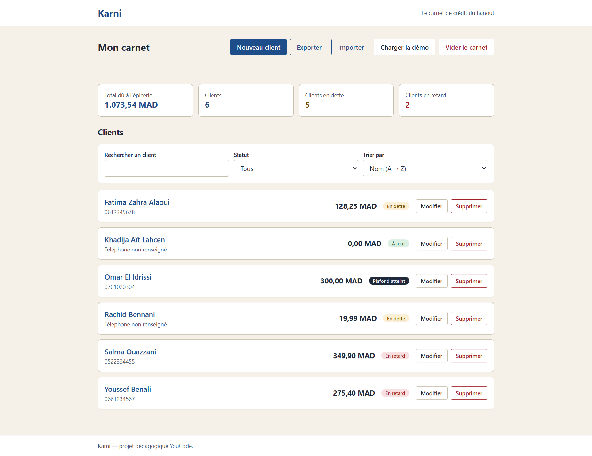
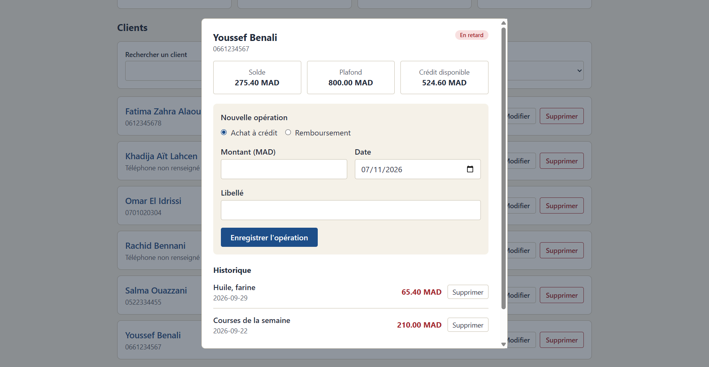
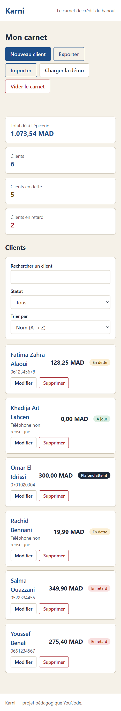
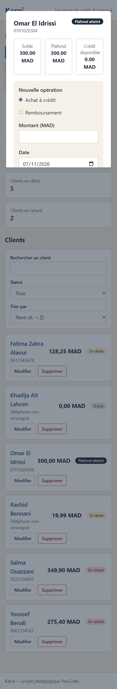

# Karni — carnet de crédit pour commerces de proximité

Karni est une application web locale destinée aux épiciers et aux petits commerçants qui suivent les achats à crédit de leurs clients. Elle remplace le suivi papier par un carnet numérique permettant de gérer les clients, les achats et les remboursements, et de consulter rapidement les soldes.

L’application fonctionne dans le navigateur sans serveur applicatif ni compte utilisateur. Les données sont enregistrées dans le `localStorage` du navigateur : elles ne sont donc pas synchronisées entre appareils.

## Fonctionnalités

- Ajouter, consulter et modifier les fiches clients.
- Supprimer un client sans dette restante. La suppression est refusée si son solde est positif; ses opérations sont supprimées avec sa fiche après confirmation.
- Enregistrer des achats à crédit et des remboursements dans la fiche d’un client.
- Calculer le solde (achats moins remboursements) et le crédit disponible.
- Respecter le plafond lors de la saisie d’un achat et empêcher un remboursement supérieur à la dette restante.
- Consulter un tableau de bord : total dû positif, nombre de clients, clients endettés et clients en retard.
- Rechercher les clients par nom ou numéro de téléphone, filtrer certains statuts et trier par nom, solde ou date de la dernière opération.
- Consulter l’historique des opérations d’un client et supprimer une opération après confirmation.
- Enregistrer et recharger le carnet avec `localStorage`.
- Exporter le carnet en JSON et importer un fichier JSON après validation et confirmation.
- Charger les données de démonstration ou vider le carnet après confirmation.
- Valider les champs client et opération et afficher des erreurs dans l’interface.

Le filtre de statut propose « À jour », « En dette » et « En retard »; le statut « Plafond atteint » est affiché, mais n’est pas proposé comme filtre.

## Technologies

- HTML5 pour la structure et les formulaires.
- CSS et Tailwind CSS 4 pour la mise en page et les styles. `src/input.css` contient les tokens et composants; `assets/style.css` est le fichier compilé chargé par la page.
- JavaScript avec modules ES natifs pour l’état, les règles métier, le stockage et l’interface.
- `localStorage` pour la persistance locale.
- npm et la CLI Tailwind pour installer les dépendances et compiler le CSS.

## Prérequis

- Node.js et npm.
- Un navigateur moderne prenant en charge les modules ES, les éléments `<dialog>` et `localStorage`.
- Un serveur HTTP local pour servir le projet.

## Installation et lancement

Depuis la racine du dépôt :

```bash
npm install
npm run build
```

`npm run build` compile `src/input.css` dans `assets/style.css`. Pour reconstruire le CSS automatiquement pendant le développement :

```bash
npm run dev
```

Cette commande surveille les fichiers Tailwind et ne démarre pas de serveur web. Ouvrez `index.html` avec l’extension Live Server de VS Code ou un serveur HTTP local équivalent.

Ne lancez pas la page en ouvrant directement `index.html` avec une URL `file://` : le navigateur ne charge pas les modules ES de la même façon qu’avec HTTP et peut bloquer leur importation.

Les scripts npm réellement définis dans `package.json` sont `build` et `dev`; aucun script de test n’y est configuré.

## Architecture du dépôt

Voici l’organisation des fichiers et des dossiers du projet Karni après les dernières modifications :

```text
karni/
│
├── assets/
│   └── style.css
│
├── captures/
│   ├── dashboard-desktop.png
│   ├── fiche-client-desktop.png
│   ├── dashboard-mobile.png
│   └── fiche-client-mobile.png
│
├── exemples/
│   ├── karni-exemple.json
│   └── karni-casse.json
│
├── src/
│   ├── input.css
│   └── js/
│       ├── calculs.js
│       ├── demo.js
│       ├── fichier.js
│       ├── main.js
│       ├── state.js
│       ├── storage.js
│       ├── ui-clients.js
│       ├── ui-confirmation.js
│       ├── ui-fiche.js
│       └── validation.js
│
├── .gitignore
├── index.html
├── package.json
└── README.md
```

### Description des dossiers

- **`assets/`** : contient le fichier CSS compilé utilisé par l’application.
- **`captures/`** : contient les captures d’écran de l’application sur ordinateur et sur mobile.
- **`exemples/`** : contient un fichier JSON valide pour tester l’importation et un fichier JSON invalide contenant plusieurs erreurs.
- **`src/`** : contient les fichiers sources du projet :
  - `input.css` : fichier CSS source contenant les styles et les personnalisations Tailwind.
  - `js/` : contient les modules JavaScript organisés selon leurs responsabilités.

### Description des fichiers principaux

- **`index.html`** : structure HTML principale de l’application.
- **`package.json`** : contient les dépendances et les commandes npm du projet.
- **`.gitignore`** : définit les fichiers et dossiers ignorés par Git.
- **`README.md`** : présente le projet, son installation, son architecture et sa répartition du travail.

## Fonctionnement

Le point d’entrée `src/js/main.js` charge d’abord le carnet sauvegardé, connecte les interactions des formulaires et boutons, puis construit l’interface à partir de l’état courant.

Le flux général est :

```text
Action de l’utilisateur
  → validation et mise à jour de l’état en mémoire
  → sauvegarde dans localStorage lorsque l’action modifie les données
  → actualisation de la liste, du tableau de bord et de la fiche
```

Les données sont stockées sous la clé `karni:v1`. Si le contenu sauvegardé ne peut pas être lu ou validé au démarrage, l’application conserve une copie du texte illisible sous `karni:sauvegarde-illisible`, initialise un carnet vide et affiche une erreur de stockage. La sauvegarde reste propre au navigateur et à son origine (protocole, domaine et port).

Chaque opération référence un client par `clientId`. Le solde est la somme des achats moins la somme des remboursements; le crédit disponible est le plafond moins le solde. Les opérations sont affichées dans la fiche du client, de la plus récente à la plus ancienne. Modifier ou supprimer une opération recalcule les éléments dérivés lors du rendu.

## Modèle des données

Les montants des plafonds et des opérations sont enregistrés en centimes de MAD. Les champs saisis à l’écran sont en MAD et sont convertis avant l’enregistrement.

```json
{
  "app": "karni",
  "version": 1,
  "clients": [
    {
      "id": "c-exemple",
      "nom": "Nadia El Amrani",
      "telephone": "0677889900",
      "plafond": 120000,
      "creeLe": "2026-09-14"
    }
  ],
  "operations": [
    {
      "id": "o-exemple",
      "clientId": "c-exemple",
      "type": "achat",
      "montant": 34990,
      "libelle": "Courses du mois",
      "date": "2026-09-28"
    }
  ]
}
```

| Champ | Règle appliquée |
| --- | --- |
| `app`, `version` | Valeurs attendues : `"karni"` et `1`. |
| `clients`, `operations` | Tableaux d’objets dans le carnet. |
| `id` | Identifiant textuel non vide. Le validateur d’import refuse les doublons dans une même liste. Les identifiants client sont générés avec `crypto.randomUUID()` quand disponible; les identifiants d’opérations utilisent `genererId`. |
| `clientId` | Identifiant d’un client existant; cette relation est vérifiée à l’import. |
| `nom` | Après suppression des espaces de début et de fin : 2 à 40 caractères, lettres, espaces, apostrophes ou tirets. Le formulaire refuse aussi les noms équivalents après normalisation de la casse et des accents. |
| `telephone` | Facultatif (`""`) ou 10 chiffres commençant par `05`, `06` ou `07`. |
| `plafond` | Entier en centimes compris entre 5 000 et 1 000 000, soit 50 à 10 000 MAD. |
| `montant` | Entier en centimes compris entre 1 et 1 000 000, soit 0,01 à 10 000 MAD. |
| `type` | `"achat"` ou `"remboursement"`. |
| `libelle` | Texte de 0 à 60 caractères; un achat exige au moins 2 caractères non blancs. |
| `creeLe`, `date` | Date réelle au format `AAAA-MM-JJ`, aujourd’hui ou antérieure. |
| `exporteLe` | Date et heure ISO ajoutées à l’export. Ce champ ne fait pas partie du carnet sauvegardé dans `localStorage` et n’est pas requis à l’import. |

## Règles métier et limites de validation

- Le formulaire client accepte un téléphone vide. Les noms sont contrôlés, et le formulaire empêche les doublons de noms après normalisation de la casse et des accents.
- Le plafond est saisi en MAD avec au plus deux décimales puis stocké en centimes.
- Le montant d’une opération est saisi en MAD, converti en centimes et limité à 1–1 000 000 centimes.
- Un achat est refusé si son ajout ferait dépasser le plafond du client.
- Un remboursement est refusé s’il dépasse le solde dû au moment de la saisie.
- Le formulaire opération vérifie la date réelle au format attendu et refuse une date future.
- Un client ne peut pas être supprimé si son solde calculé est positif. Après confirmation, un client supprimable et ses opérations sont retirés du carnet.
- L’import valide la structure, les champs, les dates, les identifiants dupliqués et l’existence des références client avant de proposer le remplacement du carnet.

**Différences importantes à connaître :** la validation d’import ne rejoue pas l’ensemble des opérations pour vérifier qu’un historique importé respecte le plafond à chaque achat ou qu’un remboursement n’excède pas la dette à cette date. Elle vérifie les bornes individuelles et les références, mais pas ces règles comptables entre opérations. Elle ne refuse pas non plus les noms de clients en doublon dans un fichier importé. Enfin, la validation métier des dates de saisie est faite dans le gestionnaire de formulaire; la fonction `validerOperation` seule ne valide pas la date.

## User Stories et répartition du travail

Le développement de Karni a été réparti entre quatre membres de l’équipe, selon quatre parties complémentaires : la logique métier, la gestion des données, l’interface des clients et l’interface des opérations.

### User Stories et responsables

| User Story | Fonctionnalités | Responsable(s) | Fichiers concernés |
| --- | --- | --- | --- |
| US-01 | Gestion des clients : validation des informations, ajout, modification et suppression selon le solde. | Ismail El Harouachi (A) — Logique / Najib Tnina (C) — Interface clients | `validation.js`, `calculs.js`, `main.js`, `state.js`, `ui-clients.js` |
| US-02 | Fiche client, opérations, historique, achats, remboursements et confirmations. | Riad Mehdaoui (D) — Interface opérations | `ui-fiche.js`, `ui-confirmation.js` |
| US-03 | Calcul des soldes, statuts et indicateurs du tableau de bord. | Ismail El Harouachi (A) — Logique / Najib Tnina (C) — Interface clients | `calculs.js`, `main.js`, `ui-clients.js` |
| US-04 | Recherche, filtres et tri des clients. | Ismail El Harouachi (A) — Logique / Najib Tnina (C) — Interface clients | `calculs.js`, `main.js`, `ui-clients.js` |
| US-05 | Sauvegarde et chargement des données avec `localStorage`. | Karima Abouhafsse (B) — Données | `storage.js` |
| US-06 | Exportation du carnet au format JSON. | Karima Abouhafsse (B) — Données | `fichier.js` |
| US-07 | Importation d’un fichier JSON avec validation et présentation des erreurs. | Karima Abouhafsse (B) — Données | `fichier.js` |
| US-08 | Chargement des données de démonstration et vidage du carnet. | Karima Abouhafsse (B) — Données | `fichier.js`, `demo.js` |

### Répartition des responsabilités

- **A — Ismail El Harouachi : Logique métier**
  - Validation des données.
  - Conversion des montants en centimes.
  - Vérification de l’unicité des noms.
  - Calcul des soldes et des statuts.
  - Calcul des indicateurs du tableau de bord.
  - Logique de recherche, de filtrage et de tri.

- **B — Karima Abouhafsse : Gestion des données**
  - Sauvegarde et chargement avec `localStorage`.
  - Importation et exportation des fichiers JSON.
  - Validation des fichiers importés et présentation des erreurs.
  - Chargement des données de démonstration.
  - Vidage du carnet.

- **C — Najib Tnina : Interface des clients**
  - Initialisation de l’application et gestion de l’état.
  - Affichage de la liste des clients.
  - Formulaires d’ajout et de modification.
  - Confirmations de suppression.
  - Affichage des erreurs sous les champs.
  - Interface de recherche, de filtrage et de tri.
  - Gestion des états vides et affichage du tableau de bord.

- **D — Riad Mehdaoui : Interface des opérations**
  - Affichage de la fiche client.
  - Affichage de l’historique des opérations.
  - Formulaires d’achat et de remboursement.
  - Affichage des badges et des informations de crédit.
  - Confirmations et suppression des opérations.

### Fichiers et responsables

| Fichier | Responsable |
|---|---|
| `main.js` | Najib Tnina (C) |
| `state.js` | Najib Tnina (C) |
| `validation.js` | Ismail El Harouachi (A) |
| `calculs.js` | Ismail El Harouachi (A) |
| `storage.js` | Karima Abouhafsse (B) |
| `fichier.js` | Karima Abouhafsse (B) |
| `ui-clients.js` | Najib Tnina (C) |
| `ui-fiche.js` | Riad Mehdaoui (D) |
| `ui-confirmation.js` | Riad Mehdaoui (D) |
| `demo.js` | Fichier fourni — non modifié par l’équipe |

### Collaboration entre les membres

Les User Stories ont été réalisées grâce à la collaboration entre les quatre membres de l’équipe. Les US-01, US-03 et US-04 nécessitent notamment une collaboration entre Ismail El Harouachi (A), responsable de la logique métier, et Najib Tnina (C), responsable de l’interface des clients.

Les autres User Stories ont été réparties selon les responsabilités de chaque membre, conformément au tableau ci-dessus.

## Vérifications et jeu d’essai

Aucun script de test automatisé n’est défini dans `package.json`. Les validations automatisées mentionnées ci-dessous ont été exécutées avec Node.js sur les fonctions de validation et les fichiers JSON. En complément, des tests manuels ont été réalisés directement dans le navigateur afin de vérifier les interactions réelles de l’application, notamment les formulaires, les opérations, l’importation des fichiers et la persistance des données après rechargement de la page.

| # | Action testée | Résultat attendu | Résultat vérifié | Statut |
| --- | --- | --- | --- | --- |
| 1 | Ajouter un client depuis le formulaire | Le client valide apparaît et est enregistré. | Fonction d’ajout testée directement : le client est créé; interface et sauvegarde navigateur non testées. | vérifié |
| 2 | Laisser le téléphone vide | Le formulaire accepte le client. | Validateur client exécuté : téléphone facultatif accepté. | Vérifié |
| 3 | Saisir un téléphone invalide | Une erreur de validation est produite. | Validateur client exécuté : numéro commençant par `08` refusé. | Vérifié |
| 4 | Saisir un téléphone valide | Le client passe la validation téléphone. | Validateur client exécuté : numéro commençant par `06` accepté. | Vérifié |
| 5 | Modifier puis supprimer un client | Les changements sont persistés; la suppression suit la règle de solde et demande confirmation. | Fonctions de modification et de suppression testées directement, y compris le blocage avec dette; confirmation et persistance navigateur non testées. | vérifié |
| 6 | Enregistrer un achat dans le crédit disponible | L’achat est accepté et augmente le solde. | Validateur d’opération exécuté pour un achat dans la limite; écran et sauvegarde non testés. | vérifié |
| 7 | Enregistrer un remboursement inférieur ou égal à la dette | Le remboursement est accepté et diminue le solde. | Validateur exécuté pour un remboursement égal à la dette; calcul du solde après remboursement vérifié directement. Le parcours du formulaire n’a pas été testé. | vérifié |
| 8 | Dépasser le crédit disponible ou rembourser plus que la dette | L’opération est refusée. | Validateur exécuté : dépassement du plafond et remboursement supérieur refusés. | Vérifié |
| 9 | Actualiser la page après une modification | Les données sauvegardées sont rechargées. | Persistance navigateur non testée. | vérifier |
| 10 | Exporter le carnet | Un fichier JSON horodaté est téléchargé. | Téléchargement navigateur non testé. | vérifié |
| 11 | Importer `exemples/karni-exemple.json` | Le carnet est validé et proposé au remplacement. | Validateur exécuté : fichier accepté sans erreur. | Validé |
| 12 | Importer `exemples/karni-casse.json` | Le fichier est refusé et le carnet courant est conservé. | Validateur exécuté : fichier rejeté avec 10 erreurs retournées; conservation du carnet dans l’interface non testée. | vérifié |
| 13 | Rechercher, filtrer et trier les clients | La liste correspond aux critères choisis. | Parcours d’interface non exécuté. | vérifié |
| 14 | Annuler/confirmer les actions sensibles | L’annulation conserve les données; la confirmation applique l’action. | Parcours des fenêtres de confirmation non exécuté. | vérifié |
| 15 | Saisir une date invalide ou future pour une opération | L’opération est refusée et une erreur de date est affichée. | Contrôle présent dans `main.js`; exécution du formulaire non testée. | vérifié |

## Difficultés rencontrées

Pendant le développement de Karni, l’équipe a rencontré plusieurs difficultés liées à la collaboration et à l’intégration du code.

| Difficulté | Solution ou amélioration apportée |
| --- | --- |
| Différences dans les noms des fonctions entre les membres de l’équipe. | Harmonisation des noms des fonctions et vérification des imports et exports entre les modules. |
| Travail parfois isolé entre les membres, ce qui rendait l’intégration des différentes parties plus difficile. | Meilleure coordination entre les responsables des modules et vérification des échanges entre les fichiers. |
| Dépendances entre les modules JavaScript. | Répartition des responsabilités par module et vérification des chemins d’importation et des fonctions exportées. |
| Difficultés de synchronisation entre les branches Git et les changements réalisés par les membres. | Mise à jour du travail à partir de la branche de développement et vérification de l’état Git avant de continuer. |
| Différences constatées dans le fichier CSS généré pendant le développement. | Vérification de la compilation Tailwind et distinction entre le fichier source `src/input.css` et le fichier généré `assets/style.css`. |

Ces difficultés ont montré l’importance de définir des conventions communes, de communiquer régulièrement et de tester l’intégration des modules avant la livraison.

## Captures d'écran

### Dashboard — Desktop


### Fiche client — Desktop


### Dashboard — Mobile


### Fiche client — Mobile


## Membres de l’équipe

Le projet Karni a été réalisé par une équipe de quatre membres :

| Membre de l’équipe | Groupe |
|---|:---:|
| Ismail El Harouachi | A — Logique métier |
| Karima Abouhafsse | B — Gestion des données |
| Najib Tnina | C — Interface des clients |
| Riad Mehdaoui | D — Interface des opérations |
- Répartition des tâches : voir le tableau des User Stories ci-dessus.

## Les liens

- Dépôt GitHub : [riadeinoo/karni](https://github.com/riadeinoo/karni)
- GitHub Projects : [Tableau de gestion du projet Karni](https://github.com/users/riadeinoo/projects/9)
- Site GitHub Pages : [Le lien de GitHub Pages](https://riadeinoo.github.io/karni/)
